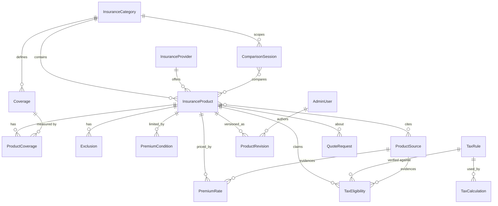

# Domain model and entity relationships

Status: **M11 proposal for review. Not implemented.** No migrations, tables or Go types exist for these entities. `database/migrations/` is still empty and no migration tool has been chosen. Column types are indicative PostgreSQL 17 types for review, not a schema.

Requirements behind each entity are in [insurance-data.md](../product/insurance-data.md) and [tax-calculation.md](../product/tax-calculation.md).

## 1. Conventions proposed for all entities

- Primary keys: `id` (`uuid` or `bigint identity`; choice is OQ-12). Public URLs use slugs or opaque IDs, never sequential IDs.
- Timestamps: `created_at`, `updated_at` as `timestamptz` in UTC. Calendar dates (effective dates, tax years) as `date` / `integer`.
- Money: `bigint` satang. Never `float` or `real`.
- Bilingual text: paired columns `*_th` and `*_en` (both `text`). This keeps queries plain SQL with pgx and needs no JSON handling; a translation table is the alternative (OQ-16).
- Enumerations: `text` with `CHECK` constraints, so adding a value is a reviewed migration.
- Deletion: published catalog data is never hard-deleted; it is retired. Personal data follows the retention rules in [compliance-security.md](../product/compliance-security.md).

## 2. Entities

### Catalog

| Entity | Purpose | Key fields | Relationships |
|---|---|---|---|
| **InsuranceCategory** | The four MVP categories (reference data). | `code` (unique), `name_th`, `name_en`, `description_th/en`, `display_order` | 1–N InsuranceProduct, 1–N Coverage |
| **InsuranceProvider** | An insurer. | `slug`, `legal_name_th/en`, `display_name_th/en`, `insurer_type` (`life`, `non_life`), `licence_ref` `[VERIFY: official]`, `website_url`, `contact_*`, `status` | 1–N InsuranceProduct |
| **InsuranceProduct** | One plan the insurer sells. Holds the admin working state, which is never read by public endpoints (INS-29). | `slug`, `category_id`, `provider_id`, `name_th/en`, `summary_th/en`, `insurer_product_code`, `policy_term_years`, `premium_term_years`, `entry_age_min/max`, `max_renewal_age`, `waiting_period_days`, `payment_frequencies`, `status`, `effective_from`, `effective_to`, `last_updated_at`, `working_version` (incremented by every working-data edit, INS-31), `published_revision_id` (latest published ProductRevision; null if never published) | N–1 category, N–1 provider; 1–N ProductCoverage, Exclusion, PremiumRate, PremiumCondition, TaxEligibility, ProductRevision; N–N ProductSource |
| **Coverage** | A coverage type shared within a category, so comparison rows line up. | `category_id`, `code`, `name_th/en`, `explanation_th/en`, `unit`, `display_order` | 1–N ProductCoverage |
| **ProductCoverage** | What one product pays for one coverage type. | `product_id`, `coverage_id`, `limit_satang` or `limit_value`, `basis` (`per_event`, `per_year`, `per_day`, `lifetime`), `sub_limit`, `copay_percent`, `deductible_satang`, `notes_th/en` | N–1 product, N–1 coverage; unique (`product_id`, `coverage_id`) |
| **Exclusion** | One exclusion of a product. | `product_id`, `standard_code` (nullable), `summary_th/en`, `is_summary` | N–1 product |
| **PremiumRate** | One row of the indicative rate table. | `product_id`, `age_min`, `age_max`, `sex` (nullable), `occupation_class` (nullable), `smoker` (nullable), `sum_insured_satang` or `plan_tier`, `payment_frequency`, `premium_satang`, `effective_from`, `effective_to`, `source_id` | N–1 product, N–1 ProductSource |
| **PremiumCondition** | A rule that limits or adjusts the rates. | `product_id`, `kind` (`entry_age`, `sum_insured_range`, `occupation_restriction`, `mandatory_rider`, `loading`, `underwriting_required`), `parameters` (`jsonb`, validated in Go), `description_th/en` | N–1 product |
| **ProductSource** | Evidence for catalog data: the master source record, shared by products. Never read directly by public endpoints (INS-32). | `type`, `title`, `url` or `document_ref`, `publisher`, `document_date`, `retrieved_at`, `stored_copy_ref` (OQ-14), `version` | N–N InsuranceProduct; 1–N PremiumRate |
| **ProductRevision** | Immutable published revision, created by each publish action or other status transition. | `product_id`, `revision_number` (exposed in the API as `published_revision`), `source_working_version` (the `working_version` it was taken from; exposed as `published_from_working_version`), `snapshot` (`jsonb`: product and all child rows, including a copy of each cited source's metadata and its `version` at publish time, INS-32), `status`, `change_note`, `admin_user_id`, `created_at`; unique (`product_id`, `revision_number`) | N–1 product, N–1 AdminUser |

### Tax

| Entity | Purpose | Key fields | Relationships |
|---|---|---|---|
| **TaxRule** | One versioned rule set for one tax year: brackets, allowances, deduction categories and caps. | `tax_year` (e.g. `2026`), `version`, `status` (`draft`, `verified`, `published`, `superseded`), `rules` (`jsonb`, validated against a Go schema), `source_refs` (Revenue Department references), `verified_by`, `verified_at`, `published_at` | 1–N TaxEligibility, 1–N TaxCalculation; unique (`tax_year`, `version`) |
| **TaxEligibility** | A product's claim to a deduction category in one tax year, verified against one rule version. | `product_id`, `tax_year`, `deduction_category` (key into TaxRule `rules`), `conditions_met` (`jsonb`), `evidence_source_id`, `status` (`unverified`, `verified`, `not_eligible`), `verified_against_rule_id`, `reviewed_by`, `reviewed_at` | N–1 product, N–1 ProductSource, N–1 TaxRule (`verified_against_rule_id`, whose `tax_year` must match) |
| **TaxCalculation** | A record of one calculation. Persistence is OQ-05. | `tax_rule_id`, `inputs` (`jsonb`), `result` (`jsonb`), `created_at` | N–1 TaxRule |

### People and interactions

| Entity | Purpose | Key fields | Relationships |
|---|---|---|---|
| **AdminUser** | Internal SafeInSiam staff who manage the catalog. | `email`, `display_name`, `role` (OQ-07), `status`, `last_login_at`; credentials depend on OQ-07 | 1–N ProductRevision, verifies TaxRule and TaxEligibility |
| **ComparisonSession** | A set of products a user is comparing, with the inputs used. Persistence is OQ-06. | `public_id`, `category_id`, `inputs` (`jsonb`, non-identifying only), `product_ids`, `created_at`, `expires_at` | N–1 category, N–N InsuranceProduct |
| **QuoteRequest** | A user's request to be contacted about a product. Depends on OQ-03. | `product_id`, `name`, `contact` (phone/email), `preferred_language`, `consent_record` (version, time, purpose), `status`, `created_at`, `delete_after` | N–1 InsuranceProduct, optional N–1 ComparisonSession |

## 3. Entity relationships

## 4. Review notes

Points for the reviewer to accept or change:

1. **Revision model.** The proposal keeps editable "current" rows plus an immutable `jsonb` snapshot per revision. The simpler alternative, fully versioned child tables, makes every query revision-aware. Snapshots make history and diffs easy and keep public queries simple. Risk: the snapshot shape must be versioned when the schema changes.
2. **Drafts of published products.** Fixed requirement: unpublished edits never change public data (INS-29). Only the mechanism is open (OQ-17): (a) public reads come from the latest published snapshot, so the working rows are admin-only, or (b) a separate draft copy per product, with the live rows changed only by publishing. The proposal favours (a). Under either option, a public query that reads the working rows directly is a defect. Under either option, too, `working_version` belongs to the working data and `revision_number` to published revisions (INS-31); `has_unpublished_changes` is derived (`working_version` ≠ the latest revision's `source_working_version`), not stored. The field list above is logical; where these values live depends on OQ-17. Public source information comes from the revision snapshot, never from the ProductSource record, so editing a source record cannot change an existing published revision (INS-32).
3. **Coverage vs ProductCoverage.** Coverage is the shared row label; ProductCoverage is the value. Without shared labels, side-by-side comparison cannot line rows up.
4. **PremiumCondition `parameters` as `jsonb`.** Condition kinds vary in shape. Each kind MUST have a Go struct and be validated on write; free-form JSON is not acceptable.
5. **TaxRule `rules` as `jsonb`.** Rules change by year and are read whole by the calculator. A versioned Go schema validates them. Published versions are immutable; a correction is a new version.
6. **TaxEligibility is per tax year and per rule version.** A product eligible in 2026 is not assumed eligible in later years. Within 2026, a verification counts only while its `verified_against_rule_id` is the published version (TAX-17). When a new version supersedes it, the eligibility is treated as under review until re-verified (TAX-18). That state is derived from the rule versions, so the published product revision is not edited. Bulk re-verification and publish sequencing are OQ-27.
7. **TaxCalculation, ComparisonSession and QuoteRequest hold user input.** Income and deductions are financial personal data; QuoteRequest holds contact data. The proposal is to keep the first two stateless in the MVP (computed per request, not stored) unless OQ-05 and OQ-06 decide otherwise, and to build QuoteRequest only after OQ-03 and the legal review.
8. **AdminUser credentials.** Authentication is not designed (OQ-07). No password or session columns are proposed until it is.
9. **No Lead/Referral entity** is proposed. Passing user details to insurers is out of the MVP.
